# 32×32 像素角色 + 霰弹枪（WASD 移动 / 鼠标左键射击）

一个可以直接跑起来的 Godot 4 小工程：32×32 像素角色，4 个方向（下 / 上 / 左 / 右）各有
`idle`、4 帧行走、2 帧射击后推动画；角色手里有一把霰弹枪，鼠标左键开火，带枪口火焰、
暖色闪光、后坐和弹壳特效。系统鼠标被隐藏；霰弹枪的瞄准靠一个**实时跟随鼠标的 90° 扇形**，
扇形里有僵尸时轮廓变红。
地面是 **Tiled 做的 20×20 草地地图**（16px 瓦片，Aseprite 出的草皮块 + 一块水井盖），角色带跟随相机；场上有一只**僵尸**会追着角色抓咬（井盖中心留着当后续刷怪锚点）。

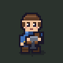

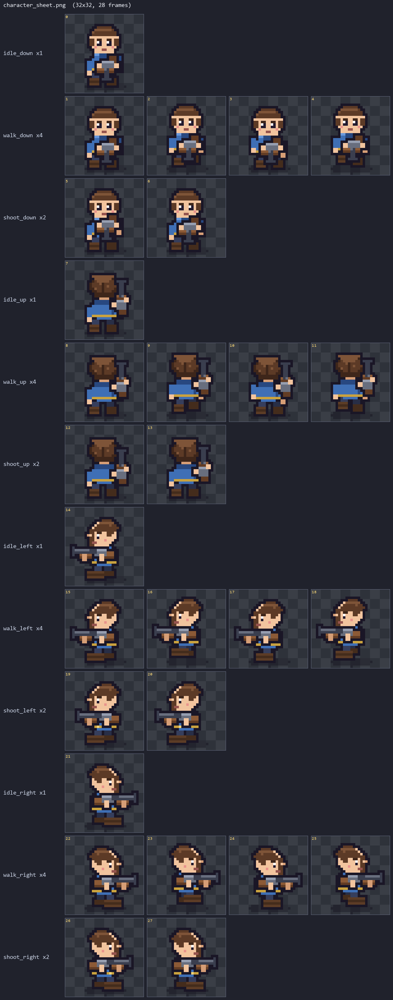

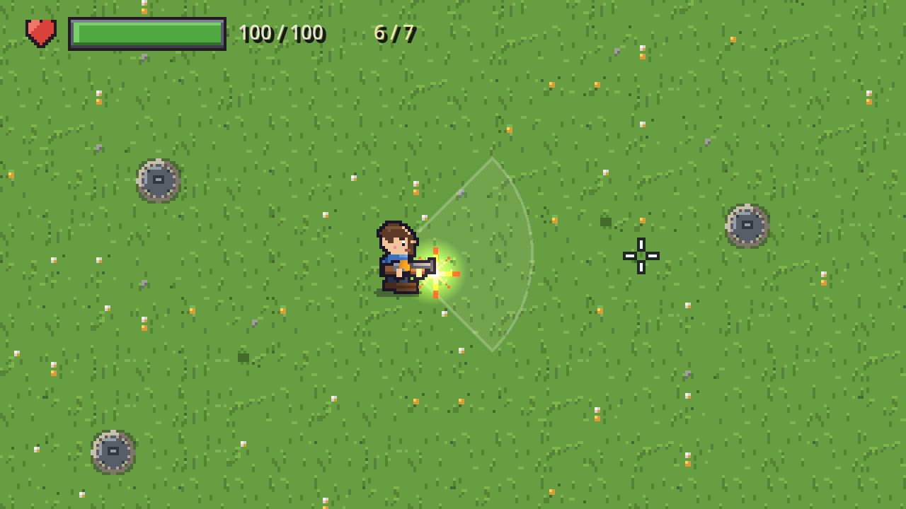

## 操作

| 输入 | 动作 |
|---|---|
| **W / A / S / D** 或方向键 | 移动（8 方向自由走；**身体朝向由鼠标决定**，像双摇杆射击） |
| **鼠标移动** | 瞄准方向跟随鼠标（屏幕上是扇形射程提示） |
| **鼠标左键** | 开火（朝鼠标方向；霰弹枪单发，步枪按住连发） |
| **R** | 换弹（3 秒；打空也会自动换） |
| **按住 Tab** | 草地：暂停游戏并打开武器轮盘，鼠标指向槽位、松开装备；基地：进 / 出建造模式 |
| **E** | 走到平台/地图边缘时：基地 → 草地，或草地 → 基地 |
| **B** | 直接切换基地 / 草地（快捷键，不用走到边上） |
| **鼠标左键点家具栏** | 基地建造模式下选择 / 取消选择要建造的家具（数字键 1 也能选，只是界面不再显示数字） |
| **鼠标左键** | 基地里放置家具；按住已有家具可以**拖动**换位置 |
| **鼠标右键** | 指着家具就**回收**进仓库；指着空地就**取消当前选择** |
| **鼠标滚轮** | **旋转**：指着家具就转它（90° 一档），指着空地就转下一件的朝向 |
| **U** | 基地里升级鼠标指着的那件家具 |
| **Delete** | 清空基地里所有已放置的家具 |

## 目录结构

```
C:\game\test
├─ project.godot              Godot 工程配置（320×180 视口，窗口 4 倍放大）
├─ scenes\
│   ├─ main.tscn              演示场景：Tiled 草地、网格、HUD、准心、玩家
│   ├─ meadow.tscn            地形：读 .tmj 的 TileMapLayer
│   ├─ player.tscn            玩家：CharacterBody2D + AnimatedSprite2D + 碰撞体 + 相机
│   ├─ muzzle_flash.tscn      枪口特效：爆闪序列 + 短暂 2D 光
│   ├─ zombie.tscn            僵尸：CharacterBody2D + AnimatedSprite2D
│   ├─ zombie_death.tscn      僵尸爆血特效（5 帧 + 血块粒子 + 血泊）
│   ├─ zombie_spawner.tscn    井盖刷怪器
│   ├─ crosshair.tscn         准心：跟随鼠标的 CanvasLayer
│   └─ weapon_wheel.tscn      武器轮盘（按住 Tab 暂停）
├─ scripts\
│   ├─ main.gd                HUD、--shot 截图模式、井盖刷怪点
│   ├─ meadow.gd              读取 Tiled .tmj 并填 TileMapLayer
│   ├─ player.gd              WASD 移动 + 四方向动画状态机 + 射击
│   ├─ muzzle_flash.gd        枪口火焰播放、自毁、闪光衰减
│   ├─ crosshair.gd           隐藏系统光标、准心跟随、开火张开
│   ├─ grid_overlay.gd        调试网格（F1 开关）
│   ├─ health_bar.gd          血条（外框 + 按比例裁剪填充）
│   ├─ zombie.gd              僵尸：追击 AI + 抓击 + 受击死亡
│   ├─ zombie_death.gd        僵尸死亡爆血特效
│   ├─ zombie_spawner.gd      5 个井盖各自计时出怪（3s / 每井共 5 只）
│   ├─ zombie_type.gd         僵尸类型资源（移速/攻速/攻击距离/伤害）
│   ├─ weapon_type.gd         武器类型资源（伤害/射速/弹匣/射程/换弹）
│   └─ aim_range.gd           射击范围扇形指示（有目标时变红）
├─ assets\
│   ├─ character.aseprite     ★ 角色源文件（3 图层 / 28 帧 / 12 个 tag）
│   ├─ character_sheet.png    角色精灵表（896×32，28 帧，无枪）
│   ├─ character_sheet_gun.png 带枪版精灵表（上下瞄准时用）
│   ├─ character_sheet_unarmed.png 空手版精灵表（基地里用）
│   ├─ character_sheet_build.png   建造模式精灵表（蓝图 + 扳手）
│   ├─ muzzle_flash.aseprite  ★ 枪口火焰源文件（3 帧）
│   ├─ muzzle_flash.png       火焰精灵表（72×24，3 帧）
│   ├─ crosshair.aseprite     ★ 准心源文件（2 帧：常态 / 张开）
│   ├─ crosshair.png          准心精灵表（26×13，2 帧）
│   ├─ zombie.aseprite        ★ 僵尸源文件（32 帧 / 12 个 tag）
│   ├─ zombie_sheet.png       僵尸精灵表（1024×32，32 帧）
│   ├─ weapons\
│   │   ├─ shotgun.tres        ★ 霰弹枪数值（80 / 0.8 / 7 / 3 格 / 3s）
│   │   ├─ shotgun_held.png    手持霰弹枪贴图（含手，可旋转）
│   │   └─ rifle.tres          ★ 突击步枪数值（20 / 4.8 / 20 / 8 格 / 1.5s）
│   ├─ zombie_types\
│   │   └─ normal_zombie.tres  ★ 普通僵尸数值（0.6 / 0.8 / 0 格 / 12）
│   ├─ zombie_death.aseprite  ★ 僵尸死亡爆血（48×48，5 帧）
│   ├─ zombie_death.png       爆血精灵表（240×48）
│   ├─ tiles\
│   │   ├─ grass_tiles.aseprite  ★ 瓦片源文件（16×16，16 草皮 + 2 井盖）
│   │   ├─ grass_tiles.png       瓦片集图（128×48，8 列 × 3 行）
│   │   ├─ grass_tiles.json      导出数据
│   │   └─ grass_tileset.tres    Godot TileSet（16×16，18 块）
│   └─ ui\
│       ├─ health_frame.aseprite ★ 血条外框（心形 + 血槽，72×12）
│       ├─ health_frame.png
│       ├─ health_fill.aseprite ★ 血条填充（52×8 × 3 帧：绿/黄/红）
│       ├─ health_fill.png       填充条（156×8，3 帧）
│       ├─ shotgun_icon.aseprite ★ 霰弹枪图标（20×20，轮盘用）
│       └─ shotgun_icon.png      图标图（20×20）
├─ tiled\
│   ├─ grass.tsx              Tiled 瓦片集（含 Grass 地形与权重）
│   ├─ meadow.tmj             ★ 20×20 草地场景（地面层 + 建筑预留对象层）
│   ├─ base.tsx               基地瓦片集（水泥 16 块）
│   └─ base.tmj               ★ 30×30 楼顶平台（地面层 + 家具层 + 出生点）
├─ tools\
│   ├─ make_character.lua     生成角色 + 持枪姿势 + 射击后坐帧
│   ├─ make_muzzle.lua        生成枪口火焰 3 帧（爆闪 / 收缩 / 硝烟）
│   ├─ make_crosshair.lua     生成准心 2 帧
│   ├─ make_grass.lua         生成 16 块草皮瓦片 + 2 块井盖
│   ├─ make_concrete.lua      生成 16 块水泥瓦片（楼顶基地）
│   ├─ make_furniture.lua     生成 4 件基地家具贴图
│   ├─ make_bed.lua           生成床（16×32）
│   ├─ make_base_map.py       生成基地 TileSet + base.tsx/base.tmj
│   ├─ make_hud.lua           生成血条外框与填充图
│   ├─ make_weapon_icon.lua   生成武器图标（霰弹枪 20×20）
│   ├─ export_nogun.lua       导出不带 gun 图层的角色精灵表
│   ├─ make_unarmed_sheet.py  合成空手版角色表（身体 + 手，没有枪）
│   ├─ make_build_sheet.py    合成建造模式角色表（手里拿蓝图 + 扳手）
│   ├─ make_rifle_icon.lua    生成突击步枪图标（20×20）
│   ├─ make_zombie.lua        生成僵尸 4 方向动画
│   ├─ make_zombie_death.lua  生成僵尸爆血死亡动画
│   ├─ spawn_test.gd          井盖刷怪循环测试
│   ├─ make_zombie_preview.py 僵尸精灵表预览
│   ├─ make_tiled_map.py      生成 grass.tsx + meadow.tmj
│   ├─ make_tiles_preview.py  瓦片集带编号预览
│   ├─ make_preview.py        带标签的精灵表预览
│   ├─ make_crosshair_preview.py 准心在两种底色上的预览
│   ├─ make_gif.py            走路 + 射击 GIF（火焰直接合成进 GIF）
│   ├─ zoom.py                放大若干帧检查像素
│   ├─ check_input.gd         注入按键/鼠标事件，验证输入映射
│   └─ smoke_test.gd/.tscn    无头冒烟测试（移动 + 射击 + 特效 + 准心）
└─ docs\                      预览图、GIF、截图（.gdignore，不参与 Godot 导入）
```

## 运行

1. 打开 Godot 4.x（本机：`C:\game\Godot_v4.7.2-stable_win64.exe\Godot_v4.7.2-stable_win64.exe`）。
2. 「导入」→ 选中 `C:\game\test\project.godot` → 打开。
3. 按 **F5** 运行。

命令行方式：

```powershell
& 'C:\game\Godot_v4.7.2-stable_win64.exe\Godot_v4.7.2-stable_win64_console.exe' --path 'C:\game\test'
```

## 美术资源清单 & 替换指南

### 清单

| 文件 | 尺寸 | 帧 / 网格 | 用途 | 源文件 |
|---|---|---|---|---|
| `assets/character_sheet.png` | 896×32 | 32×32 × 28 帧（横排） | 玩家身体（**无枪**，横向瞄准时用） | `character.aseprite` |
| `assets/character_sheet_gun.png` | 896×32 | 同上 | 玩家身体（**带枪**，上下瞄准时用） | `character.aseprite` |
| `assets/character_sheet_unarmed.png` | 896×32 | 同上 | 玩家身体（**空手**，基地里用，已清掉多余肤色） | `tools/make_unarmed_sheet.py` |
| `assets/character_sheet_build.png` | 896×32 | 同上 | 玩家身体（**拿蓝图 + 扳手**，建造模式用） | `tools/make_build_sheet.py` |
| `assets/weapons/shotgun_held.png` | 32×32 | 单帧 | 手持霰弹枪（含手，绕握把旋转） | `character.aseprite` 的 `gun` 层 |
| `assets/zombie_sheet.png` | 1024×32 | 32×32 × 32 帧 | 僵尸 4 方向 × 8 帧（idle 1 + walk 4 + attack 3） | `zombie.aseprite` |
| `assets/zombie_death.png` | 240×48 | 48×48 × 5 帧 | 僵尸死亡爆血 | `zombie_death.aseprite` |
| `assets/muzzle_flash.png` | 72×24 | 24×24 × 3 帧 | 枪口火焰（18 fps 播放一次） | `muzzle_flash.aseprite` |
| `assets/crosshair.png` | 26×13 | 13×13 × 2 帧 | 像素准心（常态 / 开火张开） | `crosshair.aseprite` |
| `assets/tiles/grass_tiles.png` | 128×48 | 16×16，8 列 × 3 行 = 24 块 | 草地瓦片 0–15，井盖 16/17 | `grass_tiles.aseprite` |
| `assets/ui/health_frame.png` | 72×12 | 单帧 | 血条外框（心形 + 血槽） | `health_frame.aseprite` |
| `assets/ui/health_fill.png` | 156×8 | 52×8 × 3 帧 | 血条填充（绿 / 黄 / 红） | `health_fill.aseprite` |
| `assets/ui/shotgun_icon.png` | 20×20 | 单帧 | 武器轮盘图标（1:1 绘制） | `shotgun_icon.aseprite` |
| `assets/ui/rifle_icon.png` | 20×20 | 单帧 | 武器轮盘图标（同时当步枪手持贴图） | `rifle_icon.aseprite` |

> `docs/` 下的 png / gif 只是文档预览图，不参与游戏。

### 格式要求

- **PNG，8-bit RGBA**（必须带透明通道），不要隔行扫描、不要九宫格切片。
- **横向条带**：所有帧排成一行，代码按 `index × 帧宽` 切 `AtlasTexture`。
- **帧顺序固定**：角色的 `DIRS = {down:0, up:7, left:14, right:21}`、僵尸 `{down:0, up:8, left:16, right:24}`，
  每方向依次是 idle 1 帧、walk 4 帧、shoot/attack 2–3 帧；换图时顺序不能变。
- **尺寸和代码常量一致**（改尺寸就要同步改常量）：

  | 资源 | 常量 / 位置 |
  |---|---|
  | 角色帧 32×32、28 帧、10/12 fps | `player.gd` 的 `FRAME_SIZE` / `DIRS` / `WALK_FPS` / `SHOOT_FPS` |
  | 僵尸帧 32×32、32 帧、7/9 fps | `zombie.gd` 的 `FRAME_SIZE` / `DIRS` / `WALK_FPS` / `ATTACK_FPS` |
  | 爆血 48×48、5 帧、12 fps | `zombie_death.gd` 的 `FRAME_SIZE` / `FRAME_COUNT` / `FPS` |
  | 枪口火焰 24×24、3 帧、18 fps | `muzzle_flash.gd` 的 `FRAME_SIZE` / `FPS` |
  | 准心 13×13、2 帧 | `crosshair.gd` 的 `FRAME_SIZE` |
  | 血条 72×12 外框、52×8 填充、填充偏移 (18,2) | `health_bar.gd` 的 `FILL_SIZE` / `FILL_OFFSET` |
  | 瓦片 16×16、8 列 | `meadow.gd` 的 `TILE_SIZE`、`tiled/grass.tsx` 的 `columns` |
  | 手持枪握把 (16,20)、枪口距离 13px | 武器 `.tres` 的 `held_pivot` / `muzzle_distance` |

- **像素风设置**：项目全局 `default_texture_filter = 0`（Nearest）+ 像素吸附；导入时不要开
  mipmap / 线性过滤，否则会糊。
- 命名和路径固定（代码里是硬编码的 `res://assets/...`），替换时保持同名同路径。

### 替换步骤

1. **有源文件的**：改 `assets/*.aseprite`，再用 `tools/` 里的 Lua 重新导出（见「重新生成素材」）；
   角色表要导出两份：`export_nogun.lua` → `character_sheet.png`，普通 `--sheet` → `character_sheet_gun.png`。
2. **只想换外观**：直接覆盖同名 PNG（尺寸、帧数、布局都不变即可），不用改代码。
3. 回 Godot 跑一次导入刷新：
   ```powershell
   & '...\Godot_v4.7.2-stable_win64_console.exe' --headless --path 'C:\game\test' --import
   ```
4. **尺寸/帧数变了**：按上表改对应常量，并同步 `tools/` 里的生成脚本。
5. **改地形瓦片**：改 `grass_tiles` 后要重新生成 `tiled/grass.tsx` + `tiled/meadow.tmj`
   （`python tools/make_tiled_map.py`），井盖瓦片 id 固定是 16（盖着）/17（开盖）。
6. **打包导出**时记得把 `*.tmj` 加进「非资源导出过滤器」，否则地图不会被打进包。

## 素材说明

### character.aseprite（角色 + 枪）

- 32×32，RGB，3 个图层：`shadow`（脚底阴影）、`hero`（身体）、`gun`（霰弹枪 + 手）。
  枪单独一层：角色精灵表导出时**把 gun 层关掉**（`tools/export_nogun.lua`），枪和手单独导出成
  `assets/weapons/shotgun_held.png`，游戏里作为一个可以自由旋转的 `Sprite2D` 贴在角色身上。
- 28 帧 / 12 个 tag，每方向 7 帧：

  | tag | 帧（1 起） | 内容 |
  |---|---|---|
  | `idle_down` / `walk_down` / `shoot_down` | 1 / 2–5 / 6–7 | 朝下 |
  | `idle_up` / `walk_up` / `shoot_up` | 8 / 9–12 / 13–14 | 朝上 |
  | `idle_left` / `walk_left` / `shoot_left` | 15 / 16–19 / 20–21 | 朝左 |
  | `idle_right` / `walk_right` / `shoot_right` | 22 / 23–26 / 27–28 | 朝右（左的镜像） |

- 走路 4 帧：接触 → 过渡（身体抬 1px）→ 反向接触 → 过渡；枪跟着身体一起上下晃。
- 射击 2 帧：第 1 帧强后坐（枪沿准星方向后退 2px），第 2 帧回收 1px。

### muzzle_flash.aseprite（枪口火焰）

- 24×24，3 帧：大星芒爆闪（白心 + 橙黄射线）→ 收缩的小星芒 → 灰白硝烟。
- 火焰是**独立精灵**，在 Godot 里按朝向贴到枪口位置，所以四方向共用一张图。

### crosshair.aseprite（准心）

- 13×13，2 帧：
  - 第 0 帧：四条 3px 短臂 + 1px 中心点，紧凑准心；
  - 第 1 帧：短臂向外张开 1px、去掉中心点，开火瞬间使用。
- 白色臂 + 1px 深色描边，亮地板和木箱上都看得清。

## 地形瓦片（Aseprite → Tiled）

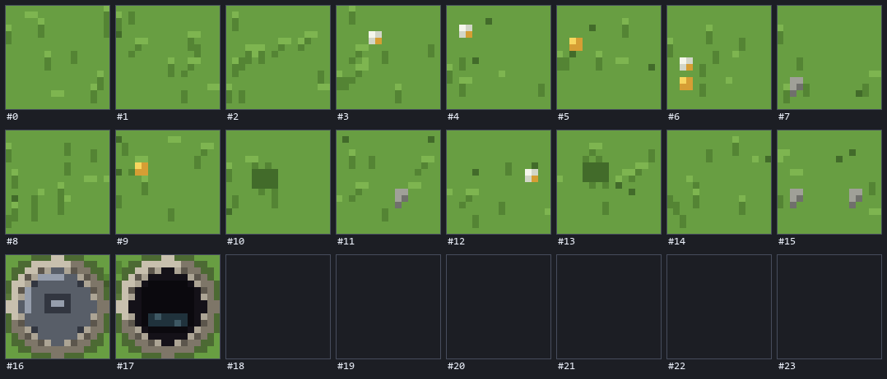

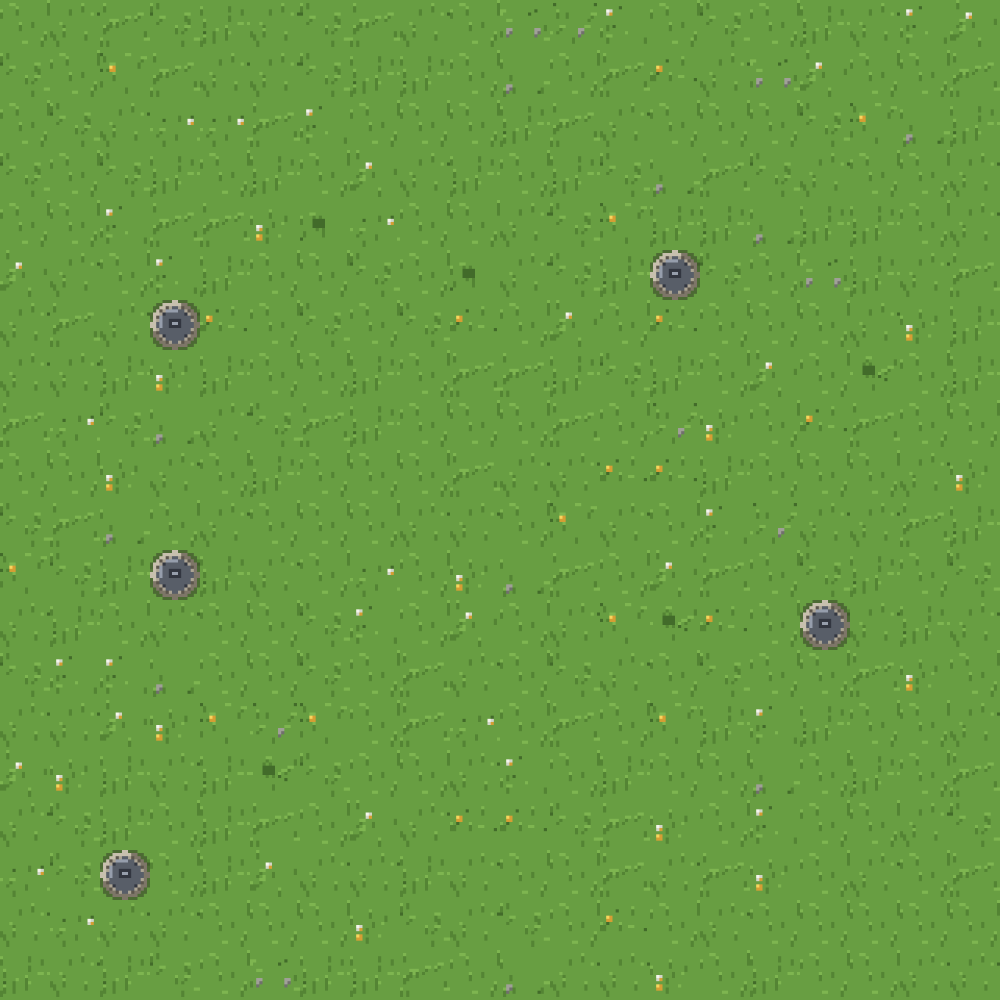

### 瓦片集：assets/tiles/grass_tiles.png

16×16 像素、8 列 × 3 行，前 16 块是可无缝平铺的草皮，第 3 行放了两块**井盖**：

| id | 内容 | id | 内容 |
|---|---|---|---|
| #0 | 纯草底 | #8 | 密草（噪点更多） |
| #1 | 草丛 A（3 片） | #9 | 草丛 + 黄花 |
| #2 | 草丛 B（4 片） | #10 | 深色草斑 |
| #3 | 草丛 + 白花 | #11 | 石子 + 草丛 |
| #4 | 白花 | #12 | 白花 + 草丛 |
| #5 | 黄花 | #13 | 深色草斑 + 草丛 |
| #6 | 白花 + 黄花 | #14 | 另一版草底 |
| #7 | 石子 | #15 | 两块石子 |
| **#16** | **水井盖（盖着铁盖）** | **#17** | **水井盖（掀开，露出井水）** |

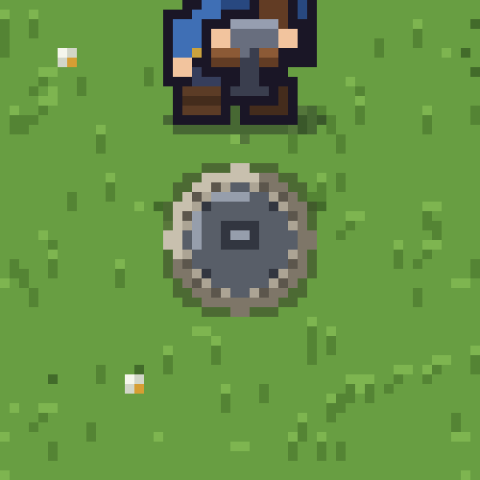

井盖瓦片自带草地底，单独摆进地图不会透出空洞；#16 / #17 是同一口井的两个状态，
以后僵尸要爬出来时把格子从 #16 换成 #17 即可。

### Tiled 文件

- `tiled/grass.tsx`：16 块草皮都标了 `Grass` 地形，并写了概率权重（纯草 0.30、密草 0.12、
  花/石子 0.02 等）。用 Tiled 的地形刷（Terrain Brush）刷草地时，会在这 16 块里随机挑，
  适合后续大面积铺地形。注意：Tiled 1.5 之后地形数据会转成 Wang set 保存，如果保存后
  权重丢了，可以在瓦片集里右键单块瓦片重新设 `Probability`。
- `tiled/meadow.tmj`：**20×20**（16px 瓦片 → 320×320 像素）的地图，包含：
  - `Grass` 层：铺满草皮（随机混搭 16 种），夹了几小片花丛，随机放了 **5 块井盖**（#16）；
  - `Spawns` 层：5 个点对象 **`well_1`..`well_5`**，各自落在井盖正中，
    属性 `kind = zombie_spawn`、`tile_id = 17`，每个井盖都是一个刷怪点；
  - `Buildings` 层：还是空的对象层，留给建筑/栅栏。

打开方式：Tiled → 文件 → 打开 `C:\game\test\tiled\meadow.tmj`（它会自动加载同目录的
`grass.tsx` 和 `../assets/tiles/grass_tiles.png`）。

### 重新生成 / 校验

```powershell
$ase = 'C:\game\Aseprite.v1.3.17\Aseprite.exe'
$py  = '...\python.exe'

# 1) 生成瓦片
& $ase -b --script 'C:\game\test\tools\make_grass.lua'
& $ase -b 'C:\game\test\assets\tiles\grass_tiles.aseprite' `
  --sheet 'C:\game\test\assets\tiles\grass_tiles.png' `
  --sheet-type horizontal --data 'C:\game\test\assets\tiles\grass_tiles.json'

# 2) 生成 tileset + 地图
& $py 'C:\game\test\tools\make_tiled_map.py'

# 3) 渲染地图做校验（libtiled 实际读一遍）
& 'C:\Program Files\Tiled\tmxrasterizer.exe' --scale 4 --no-smoothing --hide-object-layers `
  'C:\game\test\tiled\meadow.tmj' 'C:\game\test\docs\tiled_meadow.png'
```

改瓦片：编辑 `assets/tiles/grass_tiles.aseprite`（保持 16×16、8 列 × 3 行），或改
`tools/make_grass.lua` 里的 `TILES` 表（每块用 `speck` / `tuft` / `flower` / `pebble` /
`dark` 组合），井盖在 `PROPS`。改地图分布或井盖格子：`tools/make_tiled_map.py` 的
`WEIGHTS` / `WELL_CELL`。

### 已接入 Godot：Tiled 地图就是游戏地形

演示场景的地面已经换成这张 Tiled 地图（`main.tscn` 里的 `Meadow` 节点），原来的
`_draw()` 棋盘地板已经删掉。

- `assets/tiles/grass_tileset.tres`：Godot 的 `TileSet`，一个 `TileSetAtlasSource`
  引用 `grass_tiles.png`，`texture_region_size = 16×16`，18 块瓦片（16 草 + 2 井盖）全部登记。
- `scenes/meadow.tscn` + `scripts/meadow.gd`：`Ground` 是 `TileMapLayer`（`z_index = -1`，
  压在地面层最底下）。`meadow.gd` 在 `_ready()` 里用 `FileAccess` + `JSON` 读
  `res://tiled/meadow.tmj`，按 `gid - firstgid` 换算出 atlas 坐标（`id % 8`, `id / 8`），
  逐格 `set_cell()` 填进去；同时把对象层里的点读成 `spawns`
  （`{name, layer, position, properties}`），`spawns` 里就是 5 个井盖点。
  → **Tiled 是地形的唯一来源**：在 Tiled 里改完地图，回 Godot 按 F5 就直接生效，不用导数据。
- `main.gd` 启动时把 `meadow` 交给刷怪器，5 个井盖各自开始计时出怪。
- `scenes/player.tscn` 里加了 `Camera2D`：`limit_*` 卡在 0/0/320/320，地图 320×320 比
  320×180 的视口高，所以垂直方向会跟着角色滚动、到边界自动夹紧（水平方向地图与视口同宽，
  固定不动）。
- `project.godot` 打开了 `2d/snap/snap_2d_transforms_to_pixel` / `..._vertices_to_pixel`，
  相机滚动时像素不会被插值糊掉。
- 角色活动范围 `player.gd` 的 `bounds` 是 `Rect2(20, 24, 280, 272)`；原来那几个木箱
  （绘制 + 静态碰撞）已经按需求删掉了，现在场上只有草地和井盖。

### 调试：瓦片网格

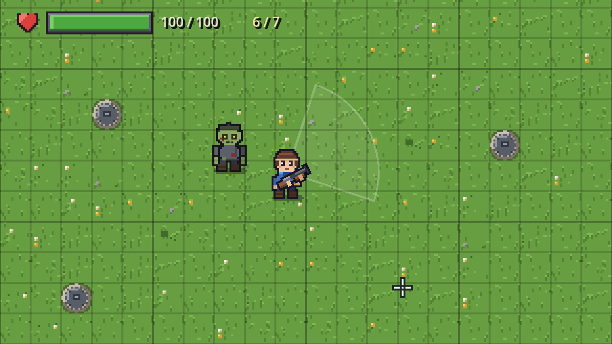

`scripts/grid_overlay.gd` 挂在 `main.tscn` 的 `Grid` 节点上（`z_index = 5`，画在角色之上、
HUD 之下），覆盖整张 320×320 地图，每 16px 一条线，每 5 格（80px）一条稍深的线方便数格子。

- 默认**开着**，进游戏就能看到格子；按 **F1** 开关。
- 截图模式（`--shot`）会先关掉网格出干净图，最后单独拍一张 `tile_grid.png`。
- 想彻底去掉：删掉 `main.tscn` 里的 `Grid` 节点即可（`grid_overlay.gd` 可以留着）。

导出注意事项：`.tmj` 不是 Godot 资源，打包时要在导出预设的
「非资源文件过滤」里加上 `*.tmj`（编辑器里直接运行不受影响）。

### 血条（HP）

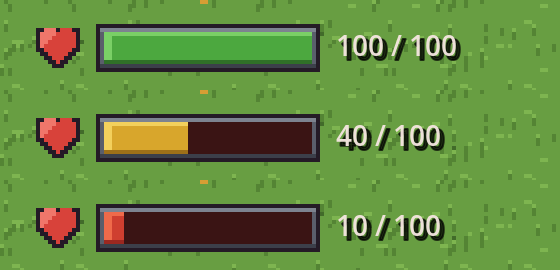

- 玩家 `player.gd`：`max_health = 100`，`health` 初始满血；提供 `take_damage()` /
  `heal()` / `set_health()`，变化时发 `health_changed(current, maximum)` 信号，
  归零时发一次 `died`。
- HUD 现在只有**血条 + 弹量**（标题、操作提示、动画调试文字都去掉了）。`scripts/health_bar.gd` 挂在 HUD 的 `Health` 控件（8, 6）上：先画 72×12 的外框图
  （左侧 11×10 心形 + 56×12 血槽），再按 `health / max_health` 从 156×8 的填充图（3 帧：绿/黄/红）里**选一帧、从左侧裁一段**
  画进血槽——整数像素裁剪，不缩放拉伸，像素保持锐利。
- 右边的 `HealthText` 显示 `100 / 100`，再右边 `Ammo` 显示 `7 / 7`（换弹时显示 `RELOAD 2.4` 倒计时）。
- 调试快捷键：**H** 扣 10 血、**J** 回 10 血（写在 `main.gd` 的 `_unhandled_input` 里，
  等僵尸攻击接上后可以删）。三档颜色见 `docs/screenshots/health_green|yellow|red.png`。
- **变色规则**：`> 50%` 绿、`20% ~ 50%` 黄、`< 20%` 红（阈值是 `health_bar.gd` 里的
  `GREEN_ABOVE` / `YELLOW_ABOVE`，改这两个常量即可调整）。
- 接伤害：僵尸命中时调用 `player.take_damage(20)`，血条会自动更新。

### 僵尸（敌人）

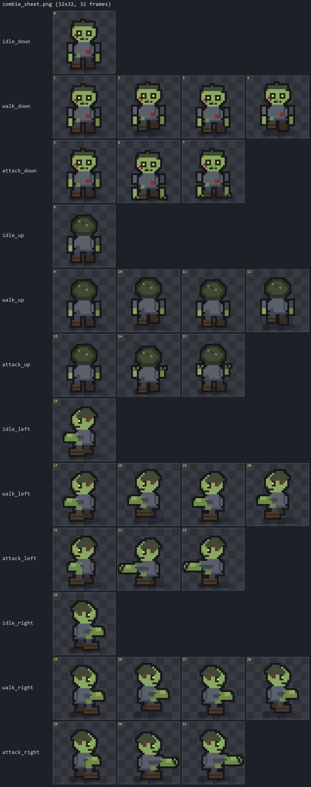

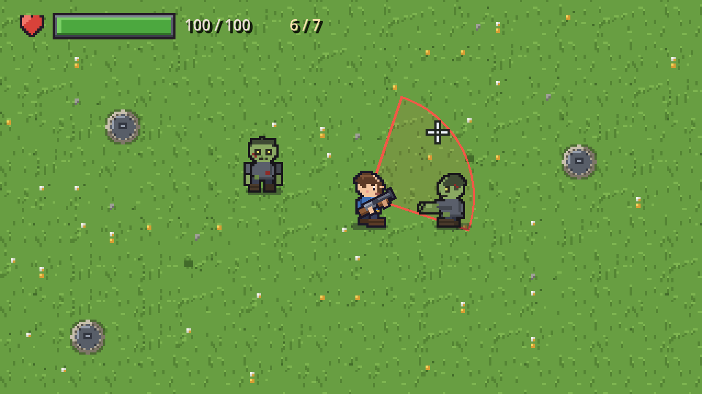

- **素材**：`assets/zombie.aseprite` → `zombie_sheet.png`，32×32，32 帧 = 4 方向 ×
  （idle 1 + walk 4 + attack 3）。绿皮肤、破衣服、黄眼睛，抓击时伸出带爪的手。
- **类型数据**：数值都在 `ZombieType` 资源里（`scripts/zombie_type.gd`），目前只有一种
  `assets/zombie_types/normal_zombie.tres` = **普通僵尸**：

  | 属性 | 值 | 说明 |
  |---|---|---|
  | `move_speed` | 0.6 | 玩家基准 95 px/s 的 0.6 倍 → 57 px/s |
  | `attack_speed` | 0.8 | 每秒 0.8 次，冷却 = 1/0.8 = 1.25 s |
  | `attack_range_tiles` | 0 | 必须和玩家**在同一格**才攻击 |
  | `damage` | 12 | 每次抓击扣 12 血 |
  | `max_health` | 50 | 霰弹枪 30 伤害，两枪死 |

  再加新怪就复制一个 `.tres` 改数值，然后在 `zombie_spawner.gd` 的 `zombie_type` 里指定。
- **攻击判定**：僵尸走到和玩家同一个 16px 格子里就停下，冷却好了播 3 帧抓击动画，
  动画第 2 帧再确认一次仍在同一格才扣血。为了能站进同一格，玩家和僵尸的碰撞层分开了
  （玩家 layer 2、僵尸 layer 4，都只和 layer 1 的场景碰撞）。
- **AI**：280px 内追着玩家走（按主轴转向），进入攻击格后站定。
- **死亡爆血**：被打死后身体炸成血块 —— `zombie_death.tscn` 播 5 帧 48×48 动画
  （化血 → 血块飞散 → 地面血泊），同时喷 16 颗血块粒子（带重力），播完在原地留一帧血泊当血迹。
- **玩家死亡**：血量归零后变灰停下（这期间不能移动，HUD 血量是 0/100），
  1.5 秒后 `main.gd` 把玩家送回出生点、回满血，并给 **1.5 秒无敌**（角色闪烁）+
  把 72px 内的僵尸推开，避免一睁眼又被围死。
- 难度旋钮：井盖 `spawn_interval` / `max_alive_per_well`、僵尸 `damage`、玩家 `respawn_invulnerable`。

### 井盖刷怪（僵尸循环）

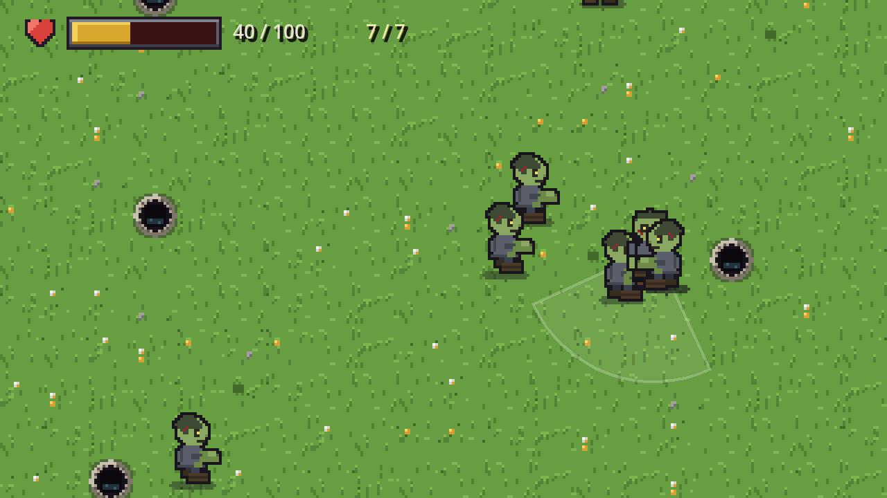

- 地图上随机放了 **5 个井盖**（生成时彼此至少隔 4 格、也避开出生点），每个井盖都是独立刷怪点。
- `zombie_spawner.gd`：`main.gd` 调用 `start(meadow)` 后，每个井盖各有一个计时器：
  - **每 3 秒**出一只（5 个井盖错开约 0.45 秒，不会同时爆）；
  - **每个井盖总共只放 5 只**（`spawn_limit_per_well`），5 只放完就**永久停刷**——
    不管这 5 只死没死，都不会再出新僵尸；
  - 井盖有自己的僵尸活着 → 开盖瓦片 `#17`，全死光 → 盖回 `#16`（`Meadow.set_well_open(cell, open)`）。
- 参数在 `zombie_spawner.gd` 顶部：`spawn_interval`（3.0）、`spawn_limit_per_well`（5）。
- 也就是说整局最多 5 井 × 5 只 = **25 只**，清完地图就安全了。

自检（测试里把间隔调成 0.2s 加速跑一轮）：

```powershell
& '...\Godot_v4.7.2-stable_win64_console.exe' --headless --path 'C:\game\test' `
  --script 'res://tools/spawn_test.gd'
```

```
wells     -> 5 个刷怪井盖
            well_1 @ (264.0, 200.0)
            well_2 @ (40.0, 280.0)
            well_3 @ (216.0, 88.0)
            well_4 @ (56.0, 104.0)
            well_5 @ (56.0, 184.0)
after 2s  -> 25 只（5 井 × 每井 5 只 = 25）
after 3s  -> 25 只（配额放完，不再增加）
wells open-> 5 / 5
killed    -> 0 只（死了也不补）
wells open-> 0 / 5（全盖回去）
after 3.5s-> 0 只（确认不再刷）
```

### 武器（WeaponType）

武器是 `.tres` 资源（`scripts/weapon_type.gd`），玩家 `weapons` 数组里放几把，轮盘就有几格。

| 属性 | 作用 | 霰弹枪 SHOTGUN | 突击步枪 RIFLE |
|---|---|---|---|
| `display_name` / `short_name` | 中文名 / 轮盘英文名 | 霰弹枪 / SHOTGUN | 突击步枪 / RIFLE |
| `icon` | 轮盘图标（20×20） | shotgun_icon.png | rifle_icon.png |
| `damage` | 单发伤害 | 80 | 20 |
| `fire_rate` | 射速（发/秒） | 0.8 | **4.8**（约 0.21 秒一发） |
| `magazine` | 弹匣容量 | 7 | 20 |
| `range_tiles` | 射程（格，×16px） | 3（48px） | 8（128px） |
| `reload_time` | 换弹秒数 | 3.0 | 1.5 |
| `show_crosshair` | 是否显示像素准心 | true | true |
| `automatic` | 按住左键连续开火 | false | true |
| `multi_hit` | 扇形内全打 / 只打最近一个 | true | false |
| `cone_degrees` | 命中扇形张角 | 90° | 20° |
| `tracer` | 开火弹道曳光 | false | true |
| `show_cone` | 显示扇形射程提示 | true | false |
| `aim_line` | 瞄准辅助线（白 → 红） | false | true |

- **霰弹枪**：90° 扇形提示，扇形里有僵尸时轮廓变红，一枪 80 伤害；
  准心固定钉在**扇形圆弧的正中间**（射程处、正对瞄准方向），不跟鼠标乱跑。
- **突击步枪**：显示准心，另外从枪口拉一条白色瞄准辅助线；20° 扇形里有目标时线变红，
  并直接连到目标身上（`aim_range.gd` 的 `_draw_aim_line()`）。
  辅助线的起点用 `player.muzzle_position()`、终点用同一个“最近的敌人 / 最大射程点”，
  和开火时的弹道曳光**完全重合**。
- 瞄准方向是从**持枪手**（`muzzle_origin()`）往鼠标算的，所以三条线（瞄准线 / 曳光 / 准心）同源。
- **步枪的准心被约束在瞄准线上**：`crosshair.gd` 的 `_clamp_to_aim_line()` 把鼠标投影到
  “枪口 → 线末端（目标或射程尽头）”这段上并夹住，所以准心只会**沿瞄准线滑动**，
  最远停在线的末端，不会跑到线外或超出射程（实测垂距 < 0.3px）。
- 瞄准线只画到线末端（目标或射程尽头），**不会越过准心再往前画**；鼠标超出射程时准心停在末端，
  线也就到此为止。4.8 发/秒（约 0.21 秒一发），20 发弹匣，3 发打死一只僵尸。
- 换枪时弹药重置为满匣（简单处理）；射击判定和瞄准提示共用 `player.is_in_shot_range()`，
  所以"线红 / 扇形红"就是一定打得到。

### 枪跟着鼠标转（旋转枪 + 原画姿势混合）

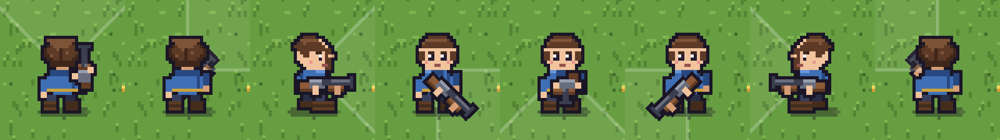

角色身体只有 4 方向动画，所以枪用了**两套表混合**，随瞄准角度自动切换：

| 瞄准方向 | 用哪套 | 效果 |
|---|---|---|
| 横向为主（`|x| ≥ |y|`） | `character_sheet.png`（无枪）+ 旋转枪 `Gun` | 枪按角度精确旋转，左右用 `flip_h` 镜像 |
| 竖向为主（`|y| > |x|`） | `character_sheet_gun.png`（原画自带枪和手） | 上/下用原来那套姿势，最自然 |
| 斜角（含朝上斜角） | 无枪表 + 旋转枪（始终 `z_index = 2`，在身体前面） | 整把枪都看得见，不被身体挡 |

- `player.gd`：`_build_sprite_frames(path)` 建两套 `SpriteFrames`，`_update_gun()` 里按
  `absf(aim.y) > absf(aim.x)` 切换，切换时隐藏/显示旋转枪并重播同名动画。
  旋转枪**永远画在身体前面**（`z_index = 2`），斜着瞄也不会被身体挡住。
- 旋转枪的关键代码：
  - 朝左半边：`flip_h = true` 且 `rotation = 瞄准角 - 180°`（避免枪倒过来、手还在枪下方），
    镜像后握把 x 要换算 `texture.width - pivot.x`，枪才不会跳位；
  - 朝右半边：`rotation = 瞄准角`，不镜像。
- 枪口火焰分两种摆法：旋转枪时放在枪口但 **`z_index = 1`（画在枪下面）**，不然会把枪管盖掉一截；
  用原画姿势（上下）时放在那张帧里枪口的位置（`BAKED_MUZZLE`）并画在最上层。
- 曳光、弹壳都从 `muzzle_position()`（手部 + 瞄准方向）出发。
- **身体朝向始终跟着鼠标**（`_facing = _dir_to_facing(shot_direction())`）：站着或走动都一样，
  走动只决定播 `walk_*` 还是 `idle_*`，所以可以“朝上开枪、往右走”。
- 重新导出：`export_nogun.lua` 导出无枪表，`Aseprite.exe -b assets/character.aseprite
  --sheet assets/character_sheet_gun.png --sheet-type horizontal` 导出带枪表。

### 武器（WeaponType）

武器是 `.tres` 资源（`scripts/weapon_type.gd`），玩家 `weapons` 数组里放几把，轮盘就有几格。

| 属性 | 作用 | 霰弹枪 SHOTGUN | 突击步枪 RIFLE |
|---|---|---|---|
| `display_name` / `short_name` | 中文名 / 轮盘英文名 | 霰弹枪 / SHOTGUN | 突击步枪 / RIFLE |
| `icon` | 轮盘图标（20×20） | shotgun_icon.png | rifle_icon.png |
| `damage` | 单发伤害 | 80 | 20 |
| `fire_rate` | 射速（发/秒） | 0.8 | **4.8**（约 0.21 秒一发） |
| `magazine` | 弹匣容量 | 7 | 20 |
| `range_tiles` | 射程（格，×16px） | 3（48px） | 8（128px） |
| `reload_time` | 换弹秒数 | 3.0 | 1.5 |
| `show_crosshair` | 是否显示像素准心 | true | true |
| `automatic` | 按住左键连续开火 | false | true |
| `multi_hit` | 扇形内全打 / 只打最近一个 | true | false |
| `cone_degrees` | 命中扇形张角 | 90° | 20° |
| `tracer` | 开火弹道曳光 | false | true |
| `show_cone` | 显示扇形射程提示 | true | false |
| `aim_line` | 瞄准辅助线（白 → 红） | false | true |

- **霰弹枪**：90° 扇形提示，扇形里有僵尸时轮廓变红，一枪 80 伤害；
  准心固定钉在**扇形圆弧的正中间**（射程处、正对瞄准方向），不跟鼠标乱跑。
- **突击步枪**：显示准心，另外从枪口拉一条白色瞄准辅助线；20° 扇形里有目标时线变红，
  并直接连到目标身上（`aim_range.gd` 的 `_draw_aim_line()`）。
  辅助线的起点用 `player.muzzle_position()`、终点用同一个“最近的敌人 / 最大射程点”，
  和开火时的弹道曳光**完全重合**。
- 瞄准方向是从**持枪手**（`muzzle_origin()`）往鼠标算的，所以三条线（瞄准线 / 曳光 / 准心）同源。
- **步枪的准心被约束在瞄准线上**：`crosshair.gd` 的 `_clamp_to_aim_line()` 把鼠标投影到
  “枪口 → 线末端（目标或射程尽头）”这段上并夹住，所以准心只会**沿瞄准线滑动**，
  最远停在线的末端，不会跑到线外或超出射程（实测垂距 < 0.3px）。
- 瞄准线只画到线末端（目标或射程尽头），**不会越过准心再往前画**；鼠标超出射程时准心停在末端，
  线也就到此为止。4.8 发/秒（约 0.21 秒一发），20 发弹匣，3 发打死一只僵尸。
- 换枪时弹药重置为满匣（简单处理）；射击判定和瞄准提示共用 `player.is_in_shot_range()`，
  所以"线红 / 扇形红"就是一定打得到。

### 枪跟着鼠标转（rotating gun）


- 角色身体只有 4 方向动画，但**手里的枪是独立精灵**，按鼠标方向连续旋转：
  - `player.tscn` 里新增 `Gun`（`Sprite2D`，`z_index = 2`）；
  - 每把武器在自己的 `.tres` 里配 `held_texture`（手持贴图）、`held_pivot`（握把点像素坐标）、
    `muzzle_distance`（枪口到手柄的距离）；
  - `player.gd` 的 `_update_gun()` 每帧执行：朝右半边 `rotation = 瞄准角`；朝左半边
    **水平镜像** `flip_h = true` 且 `rotation = 瞄准角 - 180°`，这样枪不会倒过来、手也还在枪下方，
    同时镜像后握把的 x 要换算（`texture.width - pivot.x`），枪才不会跳位置。
- 枪口火焰、曳光、弹壳都改成从**枪口/手部**的世界坐标出发（`muzzle_position()`）。
- **身体朝向始终跟着鼠标**（`_update_animation` 里 `_facing = _dir_to_facing(shot_direction())`）：
  站着或走动都一样，走动只决定播 `walk_*` 还是 `idle_*`，所以可以“朝上开枪、往右走”。
- 重新导出无枪版本：`Aseprite.exe -b assets/character.aseprite --script tools/export_nogun.lua`。

### 武器轮盘（按住 Tab）

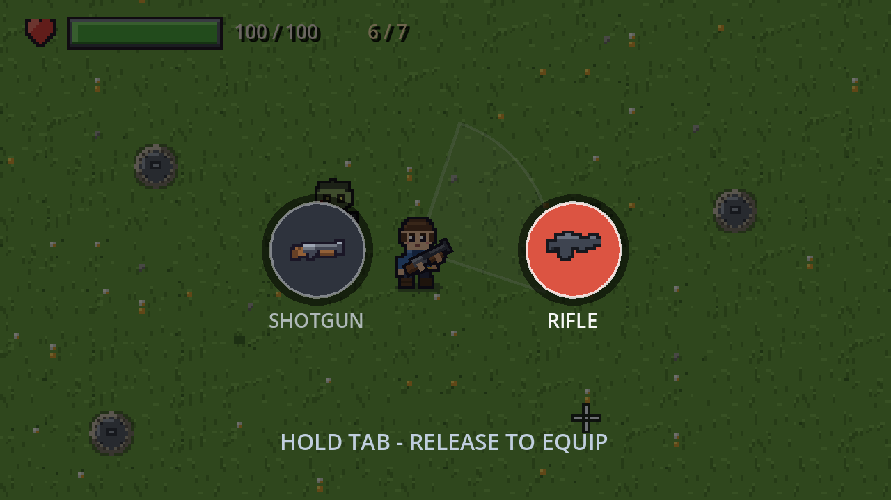

- `weapon_wheel.tscn` + `weapon_wheel.gd`（`CanvasLayer` layer 20，`process_mode = ALWAYS`）：
  - **按住 Tab**：`get_tree().paused = true` 暂停游戏，弹出轮盘，同时把系统光标显示出来；
  - 鼠标相对屏幕中心的方向决定高亮哪个槽位（死区内不高亮）；
  - **松开 Tab**：`paused = false`、重新隐藏光标，装备高亮的武器（`player.equip(index)`）。
- 槽位来自 `player.weapons` 数组：1 把在正上、2 把在左右、更多按圆周均分；每个槽位里画武器的
  `icon`（20×20 原尺寸，不缩放保持像素锐利），下面标 `short_name`。现在是霰弹枪 + 突击步枪两格。
  再加武器：往 `weapons` 里多放 `.tres`（带 `icon`）即可。
- 换枪时弹药重置为满匣（简单处理），HUD 的弹量会立刻刷新。
- 调试：`main.gd` 的 `--shot` 模式最后会调用 `open_wheel()` 拍一张轮盘截图。

## 基地（楼顶平台 + 建造系统）

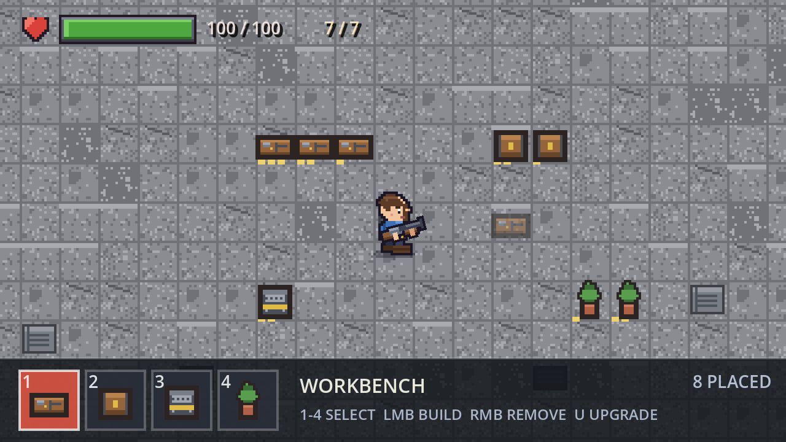

**游戏开局就在基地**（`project.godot` 的 `run/main_scene` 指向 `scenes/base.tscn`）。
基地是 **30×30 格（480×480 像素）的水泥楼顶平台**，数据全在 Tiled 里：

- `tiled/base.tmj` 30×30：
  - 地面层：水泥瓦片（4 种斑驳变化 + 裂缝 / 排水格栅 / 暗色块）随机铺满；
  - 四周一圈**女儿墙**：上下左右四种朝向（瓦片 7–10）+ 四个角（11–14），压顶连续、内侧带投影，
    边缘不会出现断层；
  - 楼顶原有的设备：楼梯舱口（出生点）、空调外机、通风口；
  - `Spawns` 层：`base_spawn` 点，玩家从舱口出来。
- 瓦片：`assets/tiles/concrete_tiles.png`（128×48，**24 块**），由 `tools/make_concrete.lua` 生成，
  `tools/make_base_map.py` 再生成 Godot 的 `concrete_tileset.tres` 和 Tiled 的 `base.tsx/base.tmj`。

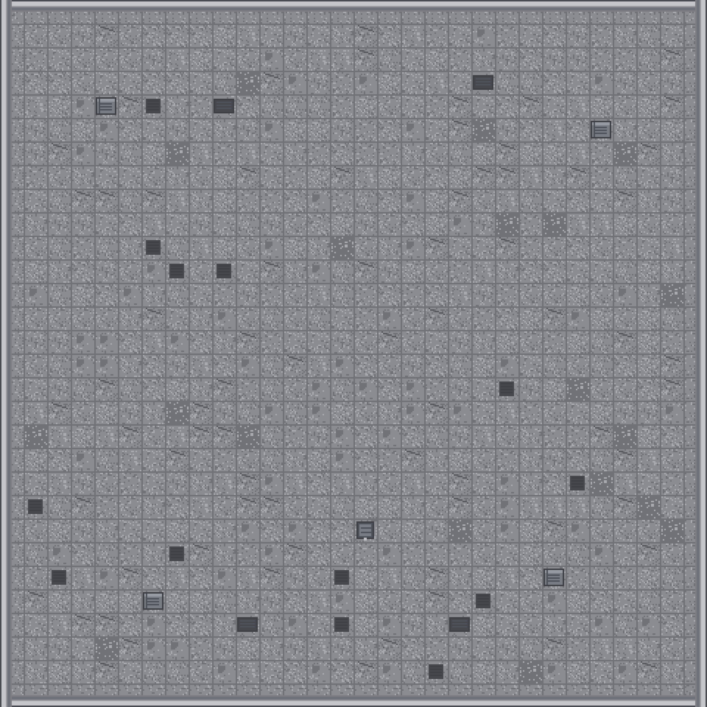
- 加载方式和草地一样：`meadow.gd` 读 `.tmj` 填 `TileMapLayer`，**Tiled 改完直接生效**。
- **外围城市**：平台四周有一圈 800×800 的城市背景（`assets/base/city_background.png`，
  由 `tools/make_city.lua` 生成）——低矮楼房群、屋顶上的空调/水箱/太阳能板/小花园、
  4 处**起火冒烟**的楼、街上**成群的僵尸**、路灯光斑，外加平台投在城市地面上的阴影。
  相机边界外扩了 160px，走到平台边就能看到楼下的城市。

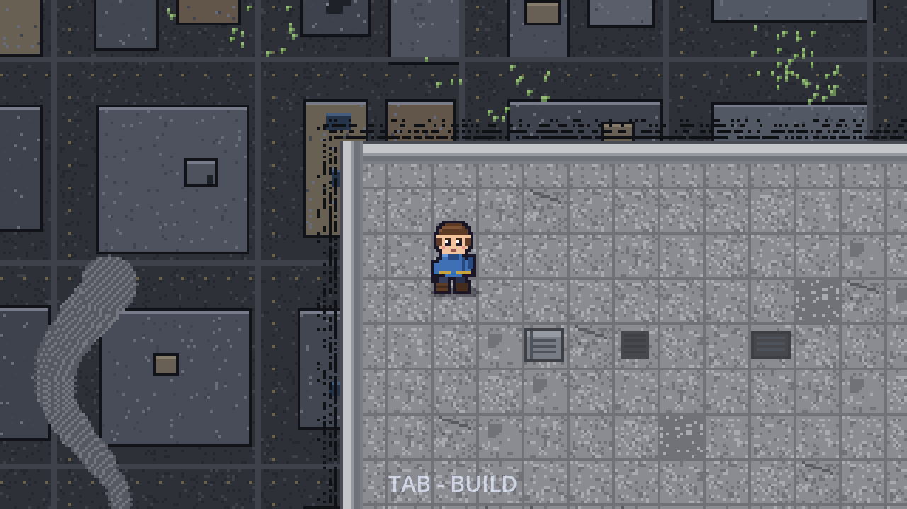

- **进出**：走到平台边缘（离女儿墙 2 格内）会浮出提示 `E - GO DOWNTOWN`，按 **E** 去草地；
  草地那边走到地图边缘会提示 `E - BACK TO BASE`，按 **E** 回基地。`B` 是不用走路的快捷键。

### 建造 / 摆放家具

- **基地里不能使用武器、手里也没有枪**：`player.set_armed(false)` 之后不能开枪、不能换弹、
  不跟鼠标瞄准，朝向跟着移动方向；身体换成**空手**那套帧（`character_sheet_unarmed.png`，
  干净的躯干、没有枪也没有浮空的手，肩侧和腰带上不会有多余的肉色像素），就是普通走路动画。
- **基地 HUD 很干净**：没有血条、没有弹药（基地里不打架），只保留底部建造栏和边缘的
  `E - GO DOWNTOWN` 提示。
- **建造模式换姿势**：按 Tab 后角色换成**双手捧着一张报纸大小的图纸**（蓝白相间的竖条纹、
  深色描边、上下有卷边高光，双手扶在图纸左右两侧），`character_sheet_build.png` 四个方向
  的 idle + 走路都有；**向左 / 向右走时看到的是图纸的侧面——一条蓝白相间的竖线**；
  **面朝上（背对镜头）时图纸抱在身前、被身体挡住，只从身体两边露出一点纸边**
  （背影帧用无手身体并清掉多余肤色，肩膀和腰带上不会有奇怪的肉色像素）；
  退出建造模式再换回空手。
- **进建造模式不预选家具**：按 Tab 只弹出家具栏（提示 `CLICK AN ITEM`），用**鼠标左键点槽位**选了某件
  家具才会出现跟随鼠标的放置预览；**放下一件后会自动取消选中**，想继续摆要再点一次槽位。
  **取消选中 = 鼠标右键点空地**（右键指着家具则是回收）。数字键 1 仍可选，只是界面不再显示数字。
- **按 Tab 进 / 出建造模式**：不按 Tab 时就是纯走路，底部只有一行 `TAB - BUILD` 提示；
  按 Tab 才弹出底部家具栏，此时才能选家具、放置、拆除、升级。
- 家具数据是 `BaseFurniture` 资源（`assets/base/*.tres`）：名字、贴图、`footprint`（占地几格）、`max_level`。
  目前只有 **床（1×2，可升到 3 级）**。
- 多格占地是通用的：`cells_for()` 把占地展开成格子列表，放/拆/预览/占位判断都按整块算，
  1×2 的床会同时占住上下两格，和别的家具重叠会被拒绝。
- **家具会挡路**：每件家具按占地挂一个 `StaticBody2D`（碰撞层 1，和地形同层），玩家和僵尸都穿不过去；
  家具本身画在 `z_index = 0`（人物是 1），所以人永远画在家具前面、不会“钻到床后面”。
- **旋转 / 拖动 / 仓库**：
  - 滚轮转 90° 一档，占地在 1×2 和 2×1 之间切换（转不开会自动保持原样）；
  - 按住左键可以把家具拖到别的格子：拖动时家具**实时跟着鼠标**（不吸附格子），松手才对齐到格子，
    放不下就弹回原位；拖动期间碰撞体临时关掉，不会挡住人；
  - 右键回收，家具退回仓库（`xN` 显示在 HUD 上，初始 8 件），放置会扣 1 件；
  - 布局 + 库存都存进 `user://base_layout.json`。
- `base_builder.gd`：
  - 鼠标左键点底部家具栏选中，右键空地取消；鼠标位置显示半透明预览（白色可放、红色不可放）；
  - **左键**放置、**右键**拆除、**U** 升级（最高 3 级，底部小方块表示等级）；
  - 全部按 **16px 格子**对齐；鼠标在平台格子外（比如飘到外面的城市上）时预览直接隐藏，
    不会出现"摆在地图外"的假象；女儿墙 / 楼顶设备瓦片（舱口/空调/通风口）上不能放；
  - 布局自动存到 `user://base_layout.json`，下次进基地自动还原；
  - **Delete** 一键清空所有家具（存档也一起清空），新档的基地是**空的**。
- 加新家具：`assets/base/` 里做一张贴图（尺寸 = 占地格数 × 16）和对应 `.tres`，然后在
  `base_builder.gd` 的 `_load_types()` 列表里加一行即可（槽位自动多一个，提示里的 `1-N` 也会自动变）。

## 关键实现

- **精灵表切片**：`player.gd` 的 `_build_sprite_frames()` 把 896×32 的图按 32×32 切成
  12 个动画（`idle_*` / `walk_*` / `shoot_*`），用 `AtlasTexture` + `SpriteFrames` 组装；
  `shoot_*` 不循环，播完靠 `animation_finished` 切回 idle/walk。
- **射击输入**：`project.godot` 里 `shoot` 绑定鼠标左键，`_physics_process` 用
  `Input.is_action_just_pressed("shoot")` 轮询（单发，不连射）。
- **瞄准**：`_aim_direction()` 取「角色 → 鼠标」的向量，量化成最近的四方向；鼠标贴在
  角色身上时保持当前朝向。开枪瞬间会转向鼠标方向。
- **枪口位置**：`MUZZLE_OFFSETS` 记录四方向的枪口偏移（和 Aseprite 里的枪管端点对应），
  火焰节点就挂在这个偏移上。
- **枪口特效**：`muzzle_flash.tscn` 播放 3 帧火焰（18fps，约 0.17s），同时挂一盏
  `PointLight2D`（径向渐变 + ADD 混合），能量在 0.18s 内衰减到 0，地上会有一圈暖光。
- **准心**：`crosshair.gd` 挂在 `CanvasLayer`（layer 10）上，`_ready` 里
  `Input.set_mouse_mode(MOUSE_MODE_HIDDEN)` 隐藏系统光标；每帧把 13×13 精灵贴到
  `get_viewport().get_mouse_position()`，用 `centered = false` + 取整保证像素对齐。
  玩家开火时发 `shot_fired` 信号，`main.gd` 转给 `crosshair.kick()` 让准心张开 0.12 秒。
  窗口失焦时自动把系统光标还回去，重新聚焦再隐藏。
  `main.gd` 按武器的 `show_crosshair` 控制显隐；默认两把枪都显示准心。
  准心位置也按武器决定：霰弹枪钉在扇形圆弧正中（`_arc_midpoint`），步枪沿瞄准线滑动
  （`_clamp_to_aim_line`）。
- **弹壳**：每次开火生成一个 `CPUParticles2D`（2×2 黄铜色贴图、one-shot、带重力），
  1 秒后自动销毁。
- **像素清晰**：`textures/canvas_textures/default_texture_filter = 0`（Nearest），
  320×180 视口 + 1280×720 窗口，正好 4 倍整数放大。

## 重新生成素材

```powershell
$ase = 'C:\game\Aseprite.v1.3.17\Aseprite.exe'

# 角色（含枪）
& $ase -b --script 'C:\game\test\tools\make_character.lua'
& $ase -b 'C:\game\test\assets\character.aseprite' `
  --sheet 'C:\game\test\assets\character_sheet.png' `
  --sheet-type horizontal --format json-array `
  --data 'C:\game\test\assets\character_sheet.json'

# 枪口火焰
& $ase -b --script 'C:\game\test\tools\make_muzzle.lua'
& $ase -b 'C:\game\test\assets\muzzle_flash.aseprite' `
  --sheet 'C:\game\test\assets\muzzle_flash.png' `
  --sheet-type horizontal --format json-array `
  --data 'C:\game\test\assets\muzzle_flash.json'

# 准心
& $ase -b --script 'C:\game\test\tools\make_crosshair.lua'
& $ase -b 'C:\game\test\assets\crosshair.aseprite' `
  --sheet 'C:\game\test\assets\crosshair.png' `
  --sheet-type horizontal --data 'C:\game\test\assets\crosshair.json'
```

也可以直接用 Aseprite 打开两个 `.aseprite` 手动改。导出时保持**单行横向排列、
每帧 32×32（火焰 24×24）**即可，Godot 里按坐标切片，不依赖 JSON。

## 自检

```powershell
# 输入映射：注入 D 键与鼠标左键
& '...\Godot_v4.7.2-stable_win64_console.exe' --headless --path 'C:\game\test' --script 'res://tools/check_input.gd'

# 移动 / 射击 / 特效
& '...\Godot_v4.7.2-stable_win64_console.exe' --headless --path 'C:\game\test' 'res://tools/smoke_test.tscn'

# 渲染 4 张截图到 docs/screenshots/
& '...\Godot_v4.7.2-stable_win64_console.exe' --path 'C:\game\test' -- --shot
```

当前输出：

```
move_right -> ["D", "Right"]     press D   -> move_right=true
shoot      -> ["Mouse1"]         click LMB -> shoot=true

start     -> anim=idle_down
right     -> pos=(192.0, 100.0) anim=walk_right
up        -> pos=(192.0, 68.0) anim=walk_up
left+down -> pos=(169.0, 91.0) anim=walk_down
released  -> anim=idle_down
shoot     -> anim=shoot_right flash=true
after 0.5s-> anim=idle_down flash=false
shoot2    -> anim=shoot_down flash=true
crosshair -> frame=0
kick      -> frame=1
after kick-> frame=0
health    -> 100 / 100
damage 30 -> 70
damage 90 -> 0 (clamped)
heal 15   -> 15
bar color -> 100%=green 51%=green 50%=yellow 20%=yellow 19%=red
zombie    -> 普通僵尸 move=0.6x(57px/s) atk=0.8/s(1.25s) range=0格 dmg=12 hp=50
hit 1     -> player hp=88 (同一格)
hit 2     -> player hp=76 (1 秒后，攻速 0.8/s)
weapon    -> 霰弹枪 dmg=80 rate=0.8/s mag=7 range=3格 reload=3.0s ammo=5
rifle     -> RIFLE dmg=20 rate=4.8/s mag=20 range=128px cone=20° auto=true multi=false
range     -> 前40=true 后40=false 前60=false 斜(20,35)=false
shoot 1   -> zombie freed=true gore=1 ammo=4（80 伤一发打死 50 血）
empty     -> ammo=0 reloading=true
reloaded  -> ammo=7 / 7
gore      -> stains=1
terrain   -> cells=400 spawns=5
wells     -> 5 个刷怪井盖（well_1 ...）
```

## 想继续加东西

- **散弹判定**：给目标加 `Area2D`，开火时沿朝向做扇形射线检测（比如 5 条 raycast，
  每条带随机角度），命中就扣血 + 溅射粒子。
- **换弹 / 泵动**：在 `make_character.lua` 加 2 帧泵动动作和对应 tag，冷却期间播放。
- **音效**：现在没有音频；给 `player.gd` 的 `_try_shoot()` 加
  `AudioStreamPlayer2D.play()` 即可（霰弹枪音效可用噪声 + 快速衰减合成）。
- **8 方向**：目前左右是镜像、斜向复用主轴朝向；要真斜向就再补 4 组帧和枪口偏移。
- **后坐反馈**：`main.gd` 里给整个场景加一点相机抖动（`Camera2D` 的 offset 噪音）会更带感。
